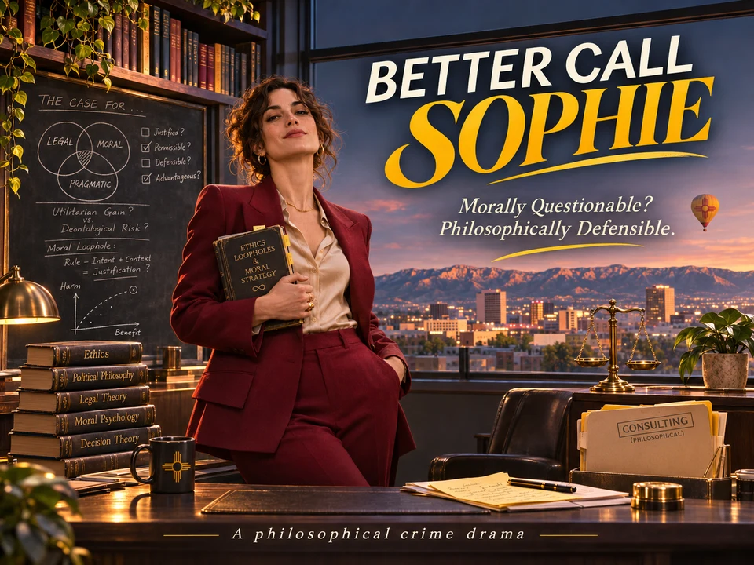
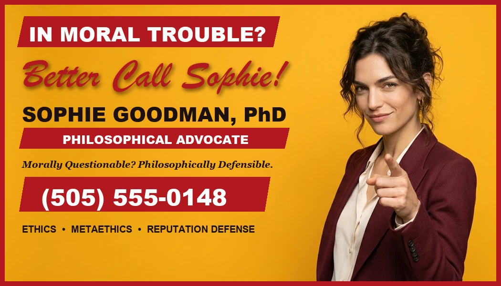
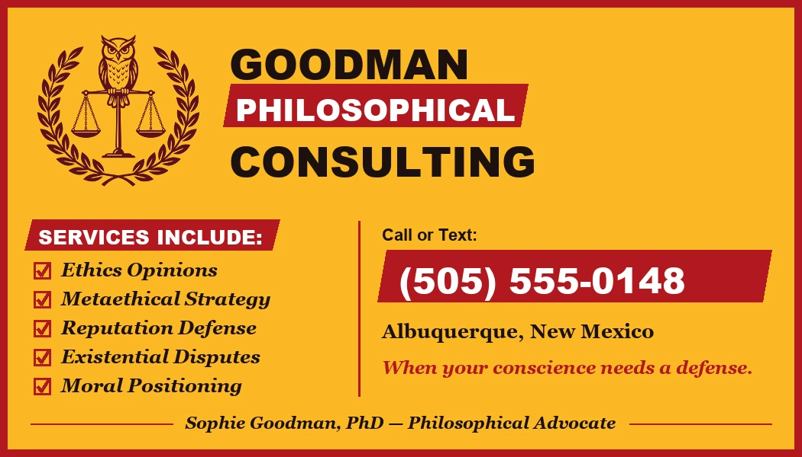

# Better Call Sophie

**Morally Questionable? Philosophically Defensible.**

An **AI-generated philosophical crime drama / dark comedy** created collaboratively by a human showrunner and ChatGPT. Meet **Dr. Sophie Goodman**: Saul Goodman's granddaughter, a philosopher who makes a living defending people accused of being *immoral* rather than *illegal*.

> "Grandpa found loopholes in the law. I find loopholes in morality."

**Status:** concept development / preproduction. **Initial video production:** Google Flow (other tools may be added as needed). No episodes have been released.

## Show artwork

### TV-series poster

  

### Goodman Philosophical Consulting — business card

<table>
  <tr>
    <th>Front</th>
    <th>Back</th>
  </tr>
  <tr>
    <td></td>
    <td></td>
  </tr>
</table>

_These are concept images; details such as names, fictional phone numbers, and branding are subject to final art review. The repository artwork consists of **lightweight, reduced-resolution WebP previews**; preserve full-resolution masters in production storage._

## The idea

A lawyer can defend a client without endorsing the client's conduct. Sophie asks: **why shouldn't professional philosophers offer a similar form of adversarial ethical advocacy?** Her arguments begin with facts, move through applied and normative ethics, and can challenge a critic's metaethical foundations. Her clients range from unpopular ordinary people to wealthy public figures. Winning an argument doesn't necessarily make her morally right.

The stakes come from reputation, public hearings, ethics panels, corporate boards, family consequences, and competing philosophical worldviews — not imaginary courts empowered to rule on morality.

## Start here

- [Agent/contributor instructions](AGENTS.md) — required reading for AI agents.
- [Specification index](spec/README.md) — canon, style, pipeline, asset governance, third-party software.
- [Series bible](spec/series-bible.md) — premise, setting, main cast, conflicts.
- [Canon and open decisions](spec/canon.md) — what is fixed versus provisional.
- [Season 1 outline](story/season-01/overview.md) — ten episode concepts.
- [Production pipeline](spec/production-pipeline.md) — Google Flow-first, tool-agnostic shot production.
- [External software](spec/third-party.md) — pinned Git submodules and their separate licenses.

## Repository layout

~~~text
AGENTS.md                   Operating instructions for AI collaborators
spec/                       Show bible, canon, style, policy, production specifications
story/                      Characters, season arcs, episode scripts and treatments
assets/                     Approved marketing and character reference imagery
production/                 Shots, prompts, generation records, edit decisions
tools/                      Project-owned scripts and automation
external/                   Third-party Git submodules, kept separate from original work
scripts/                    Repository validation utilities
~~~

The source of truth for creative continuity is **spec/canon.md**. Proposed story details should stay marked **PROPOSED** until accepted. Track every substantial generated clip, including prompt, tool/model, continuity reference, output filename, and acceptance status.

## AI-first workflow

1. Write/approve an episode outline and coherent shot list.
2. Record character, wardrobe, location, and visual continuity.
3. Generate video shots in **Google Flow** initially, then export to local production storage.
4. Review for dialogue, chronology, identity consistency, artifacts, audio, and rights concerns.
5. Assemble, caption, mix, and QC using tools chosen for the shot; retain provenance.
6. Commit scripts, prompts, metadata and approved *small* assets; avoid committing large video renders to ordinary Git.

**100% AI-generated show content** means dialogue, visual/audio performances, and finished episode assets are produced using AI, with the user and ChatGPT jointly developing, selecting, editing and directing the results. This does **not** imply that third-party tools or the pre-existing Saul Goodman character are original creations.

## Fan-fiction / rights notice

This is an **unofficial speculative fan-made spin-off concept** invoking Saul Goodman and the *Breaking Bad / Better Call Saul* universe. It is not endorsed by or affiliated with the franchise rights holders. Any commercial release, public distribution, or use of protected character/series elements requires separate rights review and, where necessary, permission or a fully original reworking. Do not assume that AI generation eliminates those obligations.

Original project text and art are separate from third-party submodule source code. See the repository LICENSE and [spec/third-party.md](spec/third-party.md).
